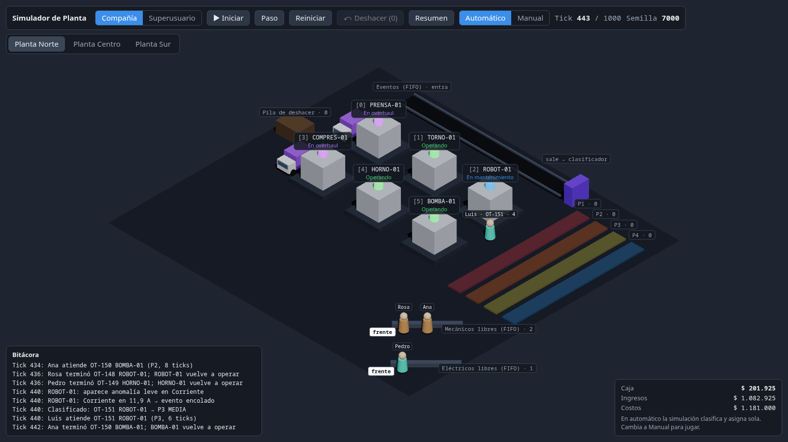

# Simulador de Monitoreo y Mantenimiento de Planta — Frontend

Proyecto del curso **Estructuras de Datos** — Universidad Nacional de Colombia.
Equipo: **Cristian Robayo** y **Kevin Toro**.

Este repositorio es la **vista** del simulador: un diorama isométrico low-poly con cámara fija donde cada
estructura de datos es un objeto del mundo que se comporta como su tipo abstracto. Toda la lógica y las
estructuras viven en el backend (Spring Boot), en el repositorio
[ProyectoFinalED](https://github.com/Torito9609/ProyectoFinalED); este frontend solo consulta su API REST.



## Las dos vistas

**Compañía (el diorama).** La planta de una compañía en 3D, con una pestaña por compañía. Encima, un HUD en
HTML con las cifras exactas y los controles:
- barra superior: iniciar, pausar, paso, reiniciar, deshacer, el interruptor automático/manual, el tick y la
  semilla;
- panel de la máquina (clic en una máquina): sensores, cola circular con sus índices, carga, parar o
  arrancar, inyectar un fallo, aprobar overhaul y reemplazar;
- panel del juego: caja, ingresos y costos; en modo manual, clasificar el siguiente evento y asignar la
  siguiente orden a un mecánico o a un eléctrico;
- bitácora y, al terminar la partida (1000 ticks), su resumen.

**Superusuario (el dashboard).** Todas las compañías a la vez:
- una tarjeta por compañía con su caja, sus máquinas por estado y sus totales (clic para abrirla);
- el ranking de fallos, global o por compañía, con la consulta "solo candidatas" y los botones de aprobar
  overhaul y reemplazar;
- el montículo de overhauls y los técnicos del fabricante, con el botón de despachar el camión;
- los formularios para crear compañías y máquinas;
- la gráfica del historial de fallos y de costo, con una ventana [a, b] seleccionable.

## Cada estructura es un objeto del mundo

El frontend no ordena, no suma ni decide qué elemento sale de una estructura: dibuja el orden que entrega
el backend. Tampoco dibuja estado interno que la estructura no expone.

| Estructura (backend) | Dónde se ve | Qué muestra |
|---|---|---|
| Arreglo dinámico (`ArrayList`) de máquinas | Las máquinas en el piso | Una por índice, en orden; la etiqueta lleva el índice (`[0] PRENSA-01`) |
| Cola circular propia (lecturas) | Anillo de 12 baldosas alrededor de la máquina seleccionada, y el mismo anillo en el HUD | El arreglo físico con sus índices, los punteros `frente` y `final` y las sobrescrituras: se ve `final` dar la vuelta |
| Cola FIFO de eventos (`ArrayDeque`) | Banda transportadora que termina en el clasificador | Entra por un extremo y sale por el otro |
| Cola con prioridad (arreglo de 4 colas) | Tablero de 4 carriles P1–P4 | Cada carril es FIFO; se resalta el carril del que sale la siguiente orden |
| Dos colas FIFO de técnicos (una por especialidad) | Dos bancas | Los libres hacen fila con el frente marcado; el ocupado camina a su máquina con su orden y los ticks restantes (×2 si es de la otra especialidad) |
| Pila de deshacer (`ArrayDeque`) | Montón de carpetas sobre un escritorio | La cima arriba; deshacer quita la de arriba |
| Árbol rojo-negro (`TreeSet`) del ranking | Tabla del ranking | El recorrido en orden; "solo candidatas" es la consulta por rango `puntaje ≥ umbral` |
| Conjunto (`TreeSet`) de nombres y etiquetas | Formularios de creación | Un nombre o una etiqueta repetida se rechaza (409) |
| Montículo (`PriorityQueue`) de solicitudes de overhaul | Panel de overhauls | La **cima** resaltada y el **orden de salida**; no el árbol, porque `PriorityQueue` no expone su arreglo |
| Cola FIFO de técnicos del fabricante | Panel de overhauls y camiones en el diorama | Los libres en fila; el camión se estaciona junto a la máquina en overhaul |
| Árbol de segmentos propio (suma y máximo) | Gráfica del historial | El **total** y el **pico** de la ventana [a, b], calculados por el árbol en O(log n); la línea punteada marca el pico |

## Stack

- React 19 + TypeScript, empaquetado con Vite.
- [React Three Fiber](https://r3f.docs.pmnd.rs/) (Three.js para React) y drei para la escena 3D.
- Sin librerías de estado, de estilos ni de gráficas: la gráfica del historial es SVG hecho a mano.

## Requisitos

- Node.js 22 o superior.
- El backend corriendo en `http://localhost:8080` (ver `docs/API.md` en el repositorio del backend).
  Si corre en otra dirección, se indica con la variable `VITE_API_URL`.

## Ejecutar

```bash
npm install
npm run dev        # abre http://localhost:5173
```

Otros comandos:

```bash
npm run build      # compila TypeScript y genera dist/
npm run lint       # revisa el código con oxlint
```

La simulación arranca en pausa: **▶ Iniciar** pone a correr el reloj y **Paso** avanza un tick. Para jugar,
cambia a **Manual**: los fallos se inyectan desde el panel de la máquina, y clasificar, asignar y despachar
el camión del fabricante se hacen con los botones.

## Organización del código

```
src/
├── api/        → cliente.ts (el único archivo que conoce las rutas) y tipos.ts (copia de docs/API.md)
├── estado/     → hooks de sondeo: usePlanta (la compañía y los controles), useSuperusuario y useHistorial
├── escena/     → el mundo 3D: un componente por estructura (AnilloLecturas, BandaEventos, TableroPrioridad,
│                 Tecnicos, PilaDeshacer, Camion) más las máquinas, las etiquetas y la animación de las colas
├── hud/        → los paneles HTML sobre la escena y el dashboard del superusuario
├── colores.ts  → la paleta única de estados, prioridades y especialidades
├── reglas.ts   → reglas del backend que se repiten solo para deshabilitar botones
└── formato.ts  → dinero y porcentajes
```

El estado se pide por **sondeo**: un `GET` cada 500 ms para la compañía y cada segundo para el dashboard,
con `setTimeout` encadenado para que nunca haya dos peticiones a la vez. No hay WebSockets.

## Uso de IA

El código de este repositorio se generó con **Claude Code** (Claude Opus 5.5): todos los commits llevan la
línea `Co-Authored-By`. El equipo decidió el estilo (diorama isométrico con cámara fija), qué objeto
representa cada estructura y el alcance de cada commit, y probó cada uno en el navegador antes de aprobarlo.
El registro del uso de IA del proyecto está en `docs/USO_IA.md` del backend.
